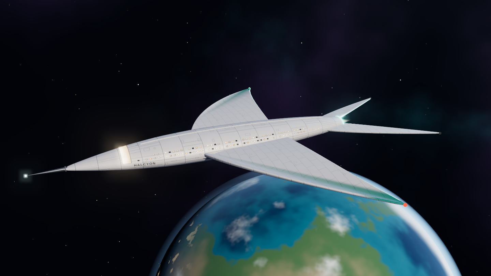
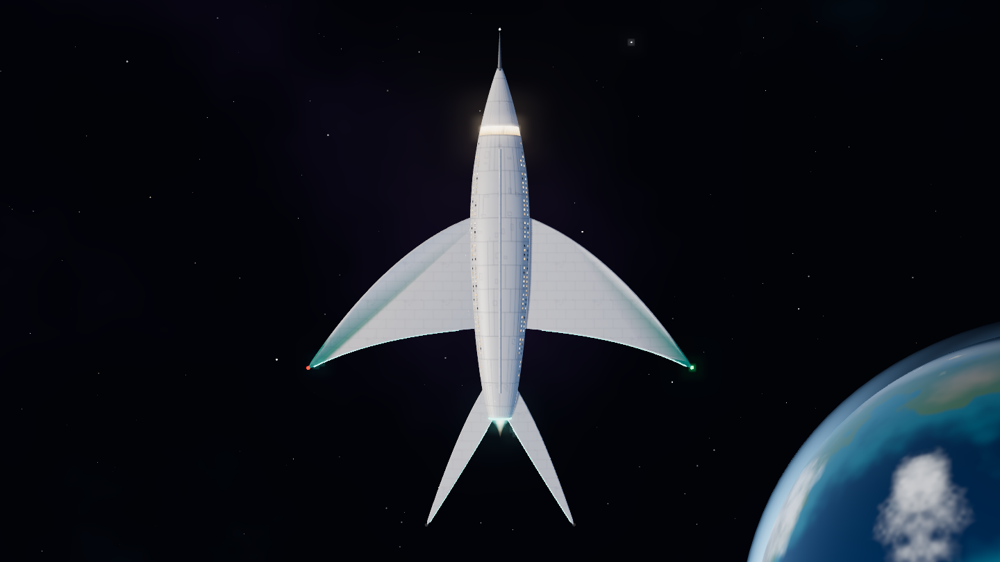
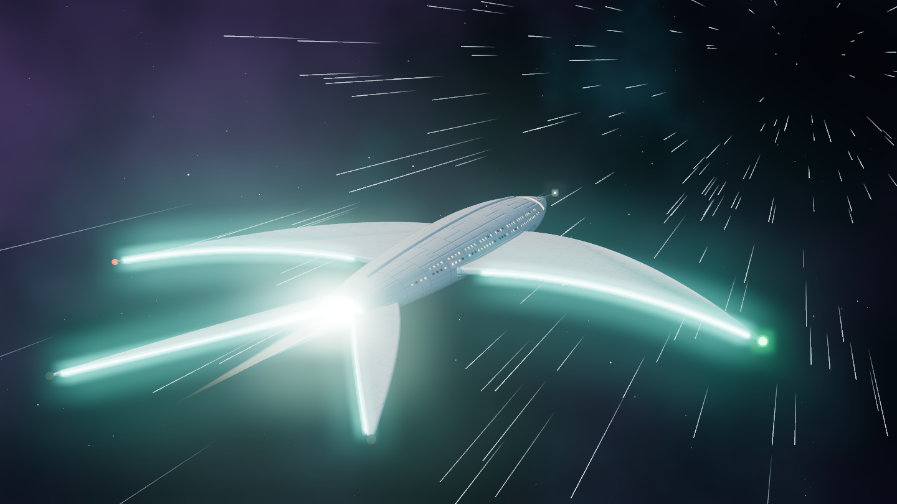
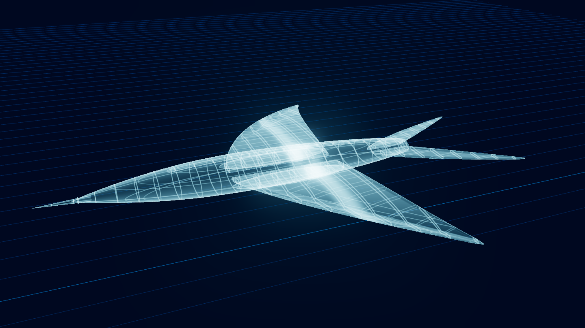

# HALCYON

**Tern-class long-range explorer · LX-07 · Lumen Exploratory Service**

HALCYON is an original starship design: a slender pearl-and-graphite hull, swept crescent wings with glowing trailing edges, a forked tail and a sensor lance at the bow. The whole ship is built in code with three.js, so you can fly it around in your browser and download it as a 3D model.

## Open the viewer

Open `index.html` in any modern browser. It loads three.js and JSZip from public CDNs, so you need to be online.

With GitHub Pages turned on for this repo, the viewer is served from the `halcyon-starship/` path of the Pages site.

## Controls

| Control | What it does |
| --- | --- |
| Drag | Orbit the ship |
| Scroll, pinch, **+** / **−** | Zoom |
| **Spin** | Slow automatic orbit, on or off |
| **View** | Hero, port side, top, bow and stern |
| **Drive** | Idle, Cruise or Full burn. The light blades flare, the drive plume grows and the stars streak past |
| **Schematic** | Blueprint hologram with station, waterline and buttock lines |
| **Rename** | Cycles through the fleet's seabird names. The pencil lets you type your own, and the name is painted on the hull |
| **Download** | A zip with an STL and a GLB of the ship, carrying whatever name is on the hull |

## Model files

| File | Use |
| --- | --- |
| [`models/halcyon.stl`](models/halcyon.stl) | 3D printing. Millimetres, Z up, 150 mm long. Parts overlap as separate shells, which slicers merge automatically. The wingtips and tail streamers are thin, so use a resin printer or scale to 200% or more for FDM. |
| [`models/halcyon.glb`](models/halcyon.glb) | Full-colour model with glowing trims and the hull name. Opens in Blender, Windows 3D Viewer and most glTF viewers. 1 unit = 1 metre. |

## Specifications

| | |
| --- | --- |
| Length overall | 410 m |
| Span | 319 m |
| Crew | 180 |
| Range between refits | 40 light-years |
| Model scale | 1:31 (GLB), 1:2733 (150 mm print) |

## Gallery

## Built with

- [three.js](https://threejs.org) r160 (MIT), loaded from jsDelivr
- [JSZip](https://stuk.github.io/jszip/) 3.10.1, loaded from cdnjs
- Fonts: Syncopate, Archivo and IBM Plex Mono from Google Fonts
